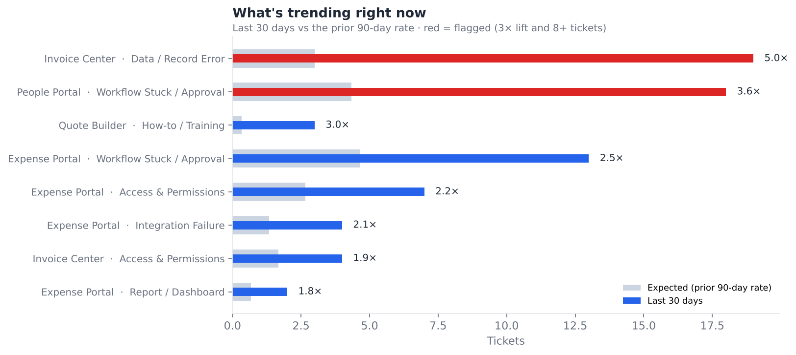
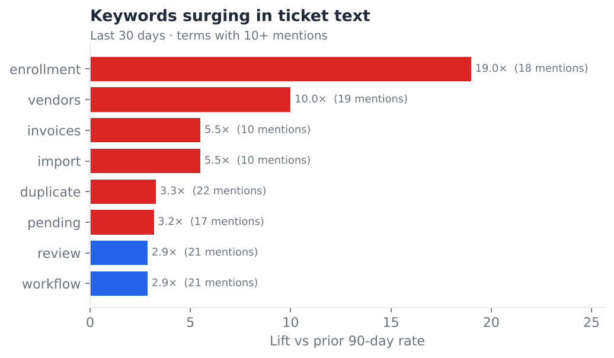
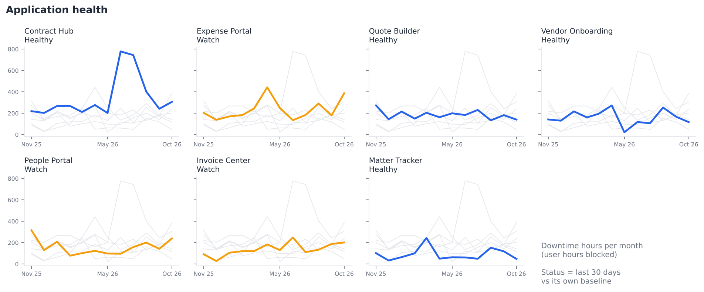
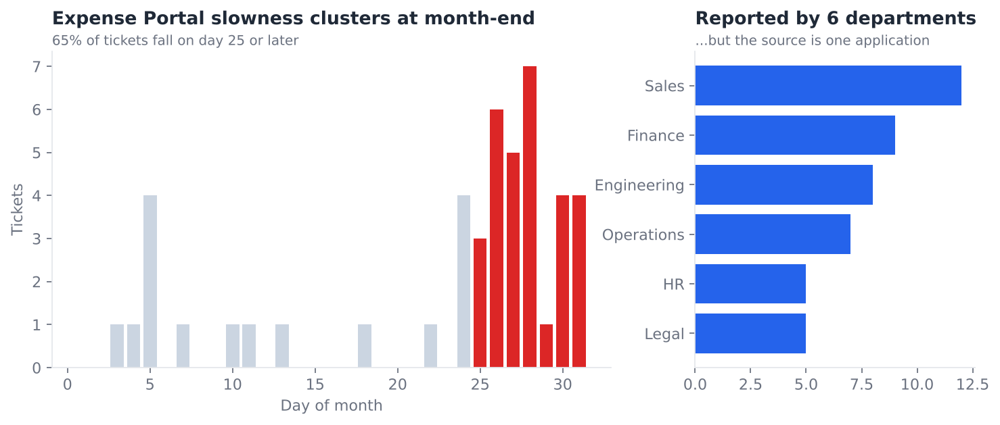
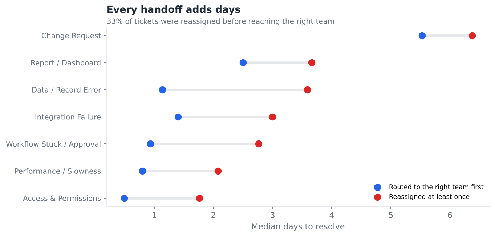
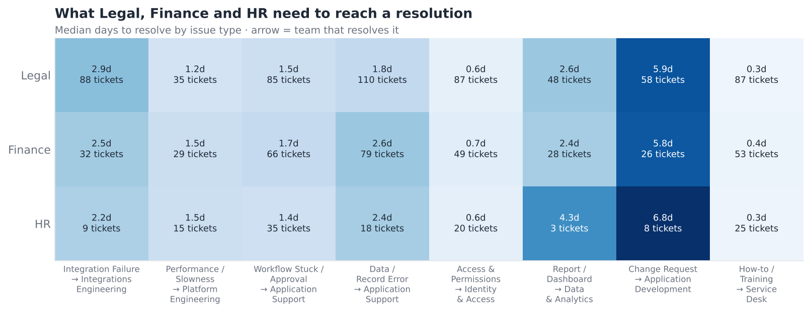

# Support Operations Trends

**Finding the blockers behind support tickets, tracing them to their source, and getting them to the team that can fix them.**

Business units (Legal, Finance, HR, Sales, Operations, Engineering) raise support tickets about the internal applications they depend on. Individually, each ticket is noise. Together, they show what's breaking, where it starts, and how much downtime it costs. This project turns that ticket stream into a decision tool:

1. **Detect** what's trending: keywords in ticket titles and descriptions, tracked over a rolling time window.
2. **Group** similar tickets with tags (keyword rules first, an LLM for the rest).
3. **Triangulate** the source: which application, which release, which time of month, regardless of which department reported it.
4. **Inform and route**: show each business unit its blockers, and connect the issue to the team that can resolve it, cutting downtime.

Built with **Google Apps Script, Google Sheets, Gemini, SQL (PostgreSQL), and Python**, on a **synthetic dataset** of 1,886 tickets across 6 departments and 7 internal applications (Nov 2025 – Oct 2026). No real company data is included.



---

## Key findings (synthetic data)

### 1. Two issues are trending right now

| Issue | Signal | Impact | Route to |
|---|---|---|---|
| **Invoice Center: duplicate invoice records** | **5.0×** the expected rate in the last 30 days, still climbing | 285 vendor records affected, with a double-payment risk | Finance + Application Support |
| **People Portal: enrollment approvals stuck** | **3.6×** expected, reported by **all 6 departments** | Employees blocked before the benefits enrollment deadline | HR + Application Support |

The keyword view catches the same signals straight from ticket text, before anyone has categorized anything: *enrollment* (19× its usual rate), *vendors*, *invoices*, *import*, and *duplicate* all surged.



### 2. One release caused most of the year's record damage

A June release broke Contract Hub's **e-signature connector**. Over eight weeks it generated 49 tickets, left **1,528 contract records** unsent (60% of all records impacted in Contract Hub for the year), and cost about **1,260 hours** of downtime. **82%** of those tickets bounced between teams before reaching Integrations Engineering. The source was clear in the ticket text ("since the June release", "e-signature", "sync"), but it wasn't being read in aggregate.

**Action:** connector regression tests before releases, and keyword routing that sends *e-signature / sync / integration* tickets straight to Integrations Engineering.



### 3. Six departments, one source

Expense Portal slowness is reported by **every department**, so it looks like a company-wide problem. But **65%** of those tickets land on **day 25 or later**: it's one application buckling under month-end load.

**Action:** Platform Engineering scales capacity for the last week of each month, and Finance sends a heads-up to submitters.



### 4. Handoffs are the hidden downtime cost

**33%** of tickets were assigned to the wrong team first. Each reassignment adds roughly **1–2.5 days** to resolution, and in total about **5,200 hours** of downtime traces back to misrouting. Integration failures are the worst case: **73%** of Legal's were reassigned.



### 5. What Legal, Finance and HR each need

Each department hits all eight issue types, but the path to resolution differs:

- **Legal** carries the heaviest load (598 tickets), led by data errors and Contract Hub integration failures.
- **Finance** data errors take a median **2.6 days**, and 46% are reassigned first.
- **HR** is dominated by stuck approvals in People Portal.

The heatmap maps each department and issue type to its median resolution time and the team that resolves it.



---

## How it works

```
 Raw tickets ─► Clean ─► Tag ────────────────────────────► Review
 (title +       │        ├ Pass 1: keyword rules on         └ 50-ticket sample,
  description)  │        │  title + description                human marks Correct/Wrong
                │        └ Pass 2: Gemini, constrained
                │           to the fixed tag list
                └ days to close, month,
                  records impacted, downtime
                                      │
            ┌───────────────┬─────────┴──────┬───────────────────┐
            ▼               ▼                ▼                   ▼
        Trending        App Health      Departments          Routing
   30-day window vs   tickets, records,  what each unit     direct vs reassigned;
   prior 90-day rate  downtime per app   needs to resolve   downtime lost to handoffs
```

**Why two-pass tagging?** If an LLM invents categories freely, you get dozens of near-duplicates ("VPN issue", "VPN problem", "remote access"). Here, keyword rules (editable in a `Taxonomy` tab) tag **89%** of tickets at **94.5% accuracy**. Only vague tickets, like *"Nothing went through"* or *"Where did my request go"*, go to Gemini, which must choose from the fixed list. Each tag also maps to the **team that resolves it**, so tagging doubles as routing.

**Why a time window?** Raw totals hide what's changing. Each application + tag pair is compared with its own recent baseline (last 30 days vs the prior 90-day rate). A pair is flagged when it reaches **3× its expected volume with at least 8 tickets**. Both thresholds are editable.

## Repository contents

| Path | What it is |
|---|---|
| [`apps-script/Code.gs`](apps-script/Code.gs) | The pipeline in Google Sheets: Clean → Tag → Review → Trending → App Health → Departments → Routing, with a custom menu |
| [`sql/support_ops_metrics.sql`](sql/support_ops_metrics.sql) | The same analysis in PostgreSQL: trending, triangulation, app health, department view, routing |
| [`analysis/analyze.py`](analysis/analyze.py) | Python replica used to score the tagger and render the charts |
| [`data/generate_synthetic_tickets.py`](data/generate_synthetic_tickets.py) | Builds the dataset with realistic planted patterns |
| [`data/tickets_synthetic.csv`](data/tickets_synthetic.csv) | 1,886 synthetic tickets |
| [`data/taxonomy.csv`](data/taxonomy.csv) | Tags, keyword rules, and the resolving team for each tag |

## Run it

**Google Sheets**
1. Create a Google Sheet. Import `data/tickets_synthetic.csv` into a tab named `Raw` and `data/taxonomy.csv` into a tab named `Taxonomy`.
2. Open *Extensions → Apps Script*, paste in `apps-script/Code.gs`, and save.
3. *(Optional)* Add `GEMINI_API_KEY` under *Project Settings → Script Properties* to enable the LLM pass.
4. Reload the sheet and choose *Support Ops → Rebuild everything*.

**Python**
```bash
pip install pandas matplotlib numpy
cd data && python generate_synthetic_tickets.py && cd ..   # optional: regenerate the data
python analysis/analyze.py                                   # prints findings, writes charts to images/
```

**SQL:** load the tagged data into a `tickets` table and run `sql/support_ops_metrics.sql`.

## Design notes

- **Privacy.** Real ticket descriptions contain names, record details, and sometimes credentials. In production, the LLM pass belongs inside the organization's own data agreements (e.g. Workspace Gemini), never a personal account. That's why this repo uses synthetic data.
- **Report to the business unit, not about it.** The department view shows each team its blockers and who resolves them. It doesn't rank departments or individual agents.
- **Prove it, then automate it.** Start with a manual export of 3–6 months and find one insight the team didn't already know. Only then is API access and scheduled refresh worth setting up.

---

*Part of [Kamsi's portfolio](https://github.com/K-B-C-04).*
